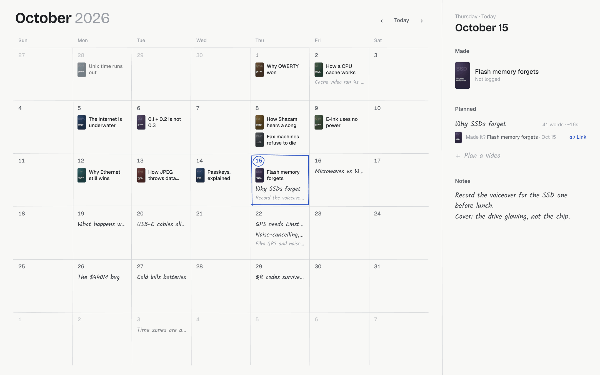
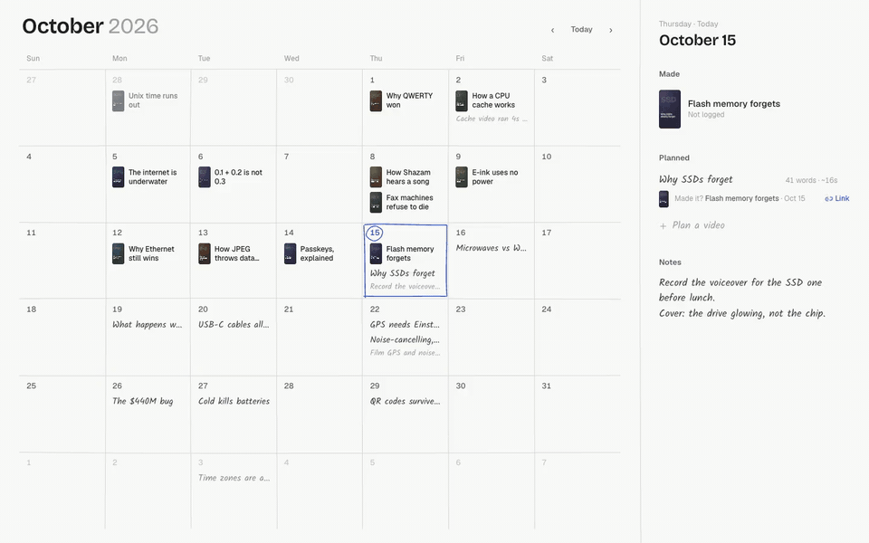
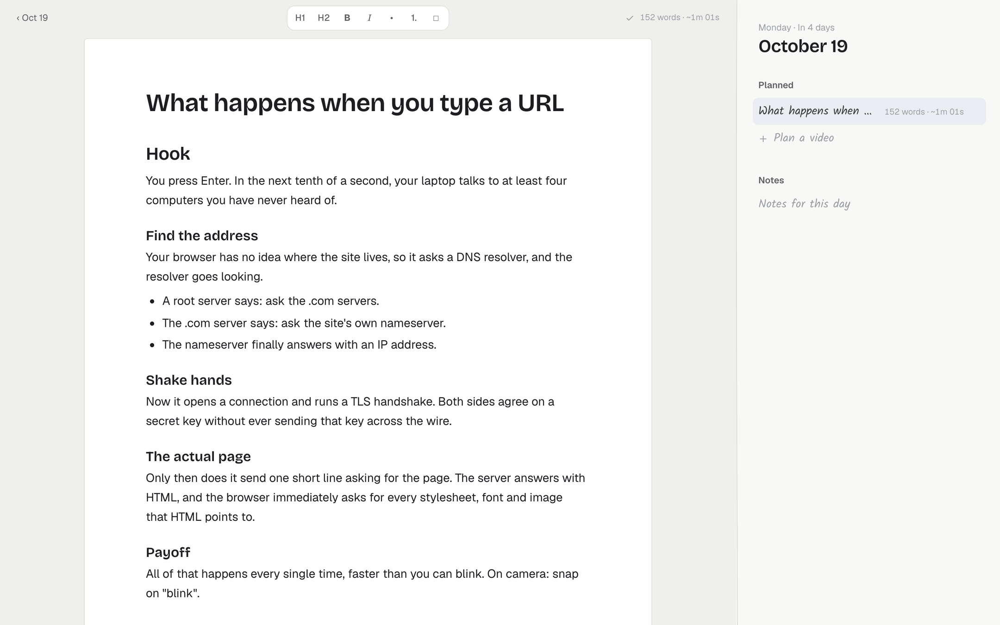
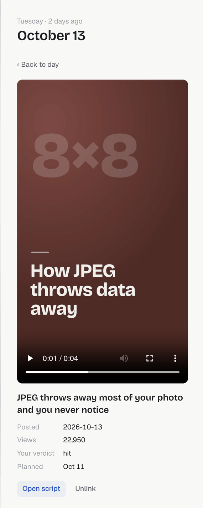
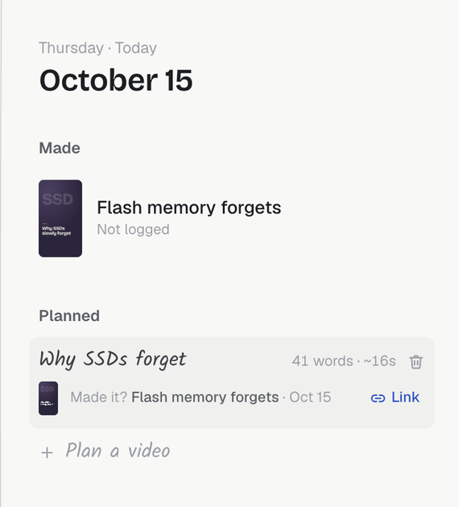
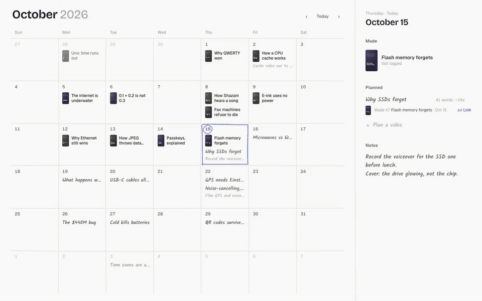

# Reels Calendar

A local content calendar for short-form video. Finished videos show up as thumbnails on the day they went out, planned videos are written in by hand, and every plan opens as a markdown script.



The screenshots and clips use a made-up demo dataset (see [Demo media](#demo-media)).

## What it does

### Plan from the keyboard, reschedule by dragging



Arrow keys move the selected day. Press `n`, type a title, and press Enter to add a plan, or ⌘Enter to add it and start writing. Drag a plan onto another day to reschedule it; the file moves with it. [Watch as MP4](docs/media/tour.mp4).

### Write the script



Clicking a plan opens its script in a markdown editor with headings, lists and checklists. The top bar shows the word count and the spoken runtime at about 150 words a minute. It saves while you type.

### Watch what you made



Every finished render appears on the calendar on the day it was posted, or the day it was made if it hasn't been posted. Click one to play it in the side rail.

If your reels folder has a library database, the rail also shows the posted date, view count and your own verdict on the video.

<br clear="right">

### Connect plans to finished videos



When a new render lands within a few days of a plan, the plan asks "Made it?" and offers that render. Linking adds a `project:` line to the plan's file, and from then on the calendar draws the plan as that video, with an "Open script" button that leads back to what you wrote.

<br clear="right">



[Watch as MP4](docs/media/link.mp4).

## Keyboard

| Key | Action |
| --- | --- |
| ← → | Previous / next day |
| ↑ ↓ | Same day last / next week |
| `t` | Jump to today |
| `[` `]` (or Page Up / Page Down) | Previous / next month |
| `n` or Enter | Start a new plan on the selected day |
| Enter (in the plan field) | Add the plan |
| ⌘Enter (in the plan field) | Add the plan and open its script |
| Esc | Close the script or video and go back to the calendar |

Double-clicking a day also starts a plan on it. Deleting a plan asks first, then moves the file to `plans/.trash` instead of erasing it.

## How it works

There is no database of its own. Everything lives in plain files on your machine, and nothing is sent anywhere.

- **Plans** are markdown files at `plans/YYYY-MM-DD/<id>.md`. Moving a plan to another day moves its file to that day's folder. Each file starts with a small frontmatter block:

  ```markdown
  ---
  title: What happens when you type a URL
  project: 2026-10-20-type-a-url
  created: 1791734580000
  ---
  # Hook

  You press Enter. In the next tenth of a second...
  ```

  `project` is only there once the plan is linked to a finished video, and `created` (milliseconds) records when the plan was written. A day's notes are saved to `plans/YYYY-MM-DD/notes.md`.

- **Finished videos** come from a reels folder (`REELS_DIR`, default `~/Movies/reels`). Each video is a folder named `YYYY-MM-DD-<slug>`, dated by the day it was made. The newest `.mp4` in that folder is used, or in `out/`, `renders/` and similar subfolders if the top level has none. Files with `draft`, `preview` or `skeleton` in the name are skipped. Without anything else, the title comes from the slug.

- **The optional library** at `REELS_DIR/library/library.db` is a SQLite file with a `videos` table. When it has a row for a project folder, the calendar uses its title, posted date, view count and verdict.

- **Thumbnails** are single frames taken with `ffmpeg` and cached in `THUMBS_DIR` (default `.cache/thumbs`). They are keyed by the render's modification time, so a re-render gets a new thumbnail.

- **One process** serves the API, the videos and the app. It listens on `127.0.0.1` only.

The hand-drawn grid and selection come from [Rough.js](https://roughjs.com/). The small animated icons are [Charade](https://github.com/goodnight000/cstack/tree/main/icons) from cstack, vendored under `src/vendor/charade` (MIT).

## Quick start

You need Node 22.13 or newer (it uses the built-in `node:sqlite`), [pnpm](https://pnpm.io/), and `ffmpeg` on your `PATH` for thumbnails.

```sh
pnpm install
pnpm dev
```

Open http://localhost:4321. In development the server runs Vite in middleware mode, so edits to `src/` reload in the browser.

Settings are environment variables:

| Variable | Default | What it is |
| --- | --- | --- |
| `PORT` | `4321` | Port to listen on |
| `PLANS_DIR` | `./plans` | Where plans and notes are written |
| `REELS_DIR` | `~/Movies/reels` | Folder of finished video projects |
| `THUMBS_DIR` | `./.cache/thumbs` | Thumbnail cache |

For example, to try it against the demo data without touching your own:

```sh
node demo/fixture.mjs
PORT=4391 PLANS_DIR=demo/.data/plans REELS_DIR=demo/.data/reels pnpm dev
```

`pnpm start` builds the app into `dist/` and runs the server in production mode. To keep it running in the background on a Mac, [SERVICE.md](SERVICE.md) shows a launchd LaunchAgent setup.

`plans/` is in `.gitignore`, so your scripts stay out of the repository.

## Demo media

Everything in `docs/media/` is generated from a synthetic dataset: invented plan titles and scripts, and video renders that are just colored title cards. Nothing in it comes from a real video library.

```sh
node demo/capture.mjs
```

This rebuilds the dataset in `demo/.data/` with `demo/fixture.mjs`, starts this checkout's server on a free port against it, drives Chrome through [playwright-core](https://playwright.dev/) with the clock fixed to 2026-10-15, and writes the screenshots, MP4s and GIFs to `docs/media/`. It needs Google Chrome and `ffmpeg`. Pass `shots`, `tour` or `link` to redo just one part.
